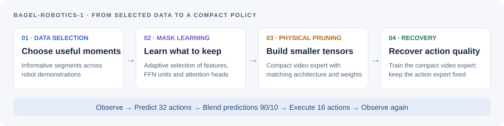

# Bagel-Robotics-1

**DEAP: Data-Efficient Adaptive Pruning for compact world-action models.**

Bagel-Robotics-1 implements three connected contributions: prune training data by selecting useful demonstration windows, learn a smaller video expert through structured masks, and recover its ability to support action prediction after physical pruning.



| Contribution | What the implementation does | Start reading |
| --- | --- | --- |
| **Data pruning through window selection** | Balances task coverage, temporal and visual diversity, motion, and episode quality when selecting demonstration windows. | [`data_selection/`](src/bagel_robotics/data_selection), [data guide](docs/DATA.md) |
| **Adaptive mask learning and physical pruning** | Learns hidden-channel, FFN-unit and cross-attention-head masks jointly with video weights, then slices the selected tensors into a compact model. | [`adaptive_pruning/`](src/bagel_robotics/adaptive_pruning), [method](docs/METHOD.md) |
| **Recovery training** | Adapts the physically smaller video expert with action supervision and reliable teacher features while keeping the action expert fixed. | [`recovery/`](src/bagel_robotics/recovery), [reproduction](docs/REPRODUCE.md) |

The evaluated video expert has **12.468B parameters, 23.95% fewer than the base video expert**. Its reported local three-seed RoboDojo results are **31.59 ± 0.33% success** and **38.36 ± 0.46 partial score /100**, with equal weighting across five suites. These results refer to the released evaluated weights.

## Start here

Use Linux and Python 3.10 for the model workflows. Install the package, then inspect the commands:

```bash
git clone https://github.com/bageldotcom/Bagel-Robotics-1.git
cd Bagel-Robotics-1
python -m pip install -e .
python -m bagel_robotics --help
```

Choose the path you need:

- **Understand the method:** [METHOD.md](docs/METHOD.md).
- **Run the released policy:** [EVALUATION.md](docs/EVALUATION.md) and [model inputs](docs/MODELS.md).
- **Prepare data and train:** [REPRODUCE.md](docs/REPRODUCE.md).

The inference weights and source are public. Training uses base model weights, demonstrations and a matching compact model for recovery. See [required inputs](docs/REPRODUCE.md#required-inputs).

## Repository map

```text
src/bagel_robotics/
  data_selection/       Demonstration conversion, selection and split checks
  adaptive_pruning/     Mask learning, tensor geometry and physical export
  recovery/             Compact-model training and resume handling
  models/               Shared video/action model implementation
  inference/            Compact loading and action prediction
  resources/            Small selection, normalization and model metadata
configs/                Recipes, local paths and model download pins
benchmarks/robodojo/     Thin XPolicyLab policy adapter
tests/                  Focused package and method checks
docs/                   Method, data, reproduction and evaluation guides
```

The command surface follows the research pipeline:

```text
prepare-data → select-data → learn-masks → prune → recover → evaluate
```

Each command reads an explicit configuration. `doctor` checks the inputs before a run. Model identifiers, training schedules and benchmark revisions live in configuration files.

## Acknowledgements

We thank the [VPP2](https://github.com/roboterax/video-prediction-policy-2), RoboDojo and XPolicyLab authors.

The technical report and citation are forthcoming.
