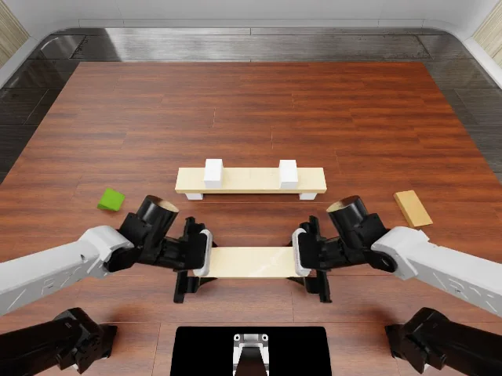
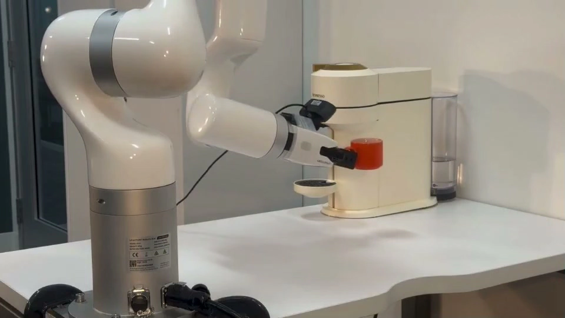
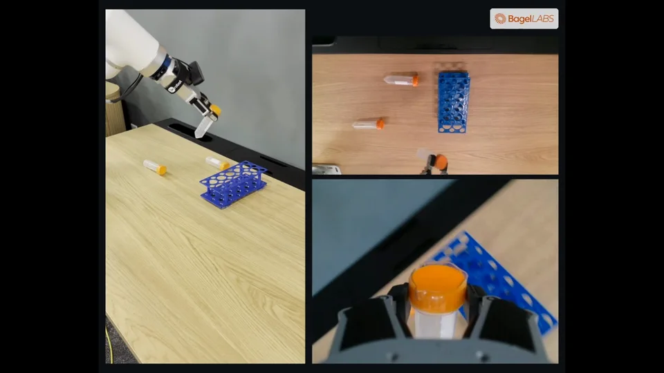

<p align="center">
  
</p>

<h1 align="center">Bagel-Robotics-1</h1>

**Bagel-Robotics-1** is Bagel Labs’ open-weight world-action model for bimanual robot manipulation. Given a task instruction, three camera views and the robot’s current state, it predicts how to move both arms and grippers.

As of November 20, 2026, Bagel Labs’ Bagel-Robotics-1 **ranked third among standalone models** on [RoboDojo-Sim](https://robodojo-benchmark.com/leaderboard?bench=sim).

<p align="center">
  <a href="https://huggingface.co/bageldotcom/Bagel-Robotics-1"></a>
  <a href="https://robodojo-benchmark.com/leaderboard?bench=sim"></a>
  <a href="#bagel-labs-robot-demos"></a>
</p>

| RoboDojo-Sim | Rank | Ranking metric |
| :--- | :--- | :--- |
| Generalization Standard | 🥇 **Tied 1st** | 46.44% success |
| Memory | 🥈 **2nd** | 57.21/100 partial score |
| Overall | 🥉 **3rd** | Average partial score across five dimensions |

[Watch and run the two-arm tower example](#two-arm-robot-manipulation-with-bagel-robotics-1-by-bagel-labs) · [Browse all 54 RoboDojo-Sim task configurations](https://robodojo-benchmark.com/leaderboard/rollouts/Bagel_Robotics_1?bench=sim)

<p align="center">
  <a href="#quick-start">Quick start</a> ·
  <a href="docs/METHOD.md">Method</a> ·
  <a href="docs/REPRODUCE.md">Training</a> ·
  <a href="docs/EVALUATION.md">Evaluation</a> ·
  <a href="#results">Results</a> ·
  <a href="#repository-map">Repository map</a> ·
  <a href="#research-and-commercial-use">Licensing</a>
</p>

## Two-arm robot manipulation with Bagel-Robotics-1 by Bagel Labs

In RoboDojo-Sim, Bagel-Robotics-1 uses both arms of an ARX X5 to build a tower. The grippers lift a wooden board together and place it across two supports. RoboDojo recorded this successful `build_tower` episode with [checkpoint `cp1000`](https://huggingface.co/bageldotcom/Bagel-Robotics-1/blob/df72c6a2962945fb0c4a1c241fc5c505883e245b/COMPLETE.json), seed 0 and layout 0.

<a href="https://media.luminis-sim.com/robodojo_eval_videos/build_tower/Bagel_Robotics_1/arx_x5/0_ckpt_name=cp1000,action_type=ee/2026-11-12_16-01-20/episode_0000000_cam_head_success.mp4"></a>

[Watch the official recording (29 seconds)](https://media.luminis-sim.com/robodojo_eval_videos/build_tower/Bagel_Robotics_1/arx_x5/0_ckpt_name=cp1000,action_type=ee/2026-11-12_16-01-20/episode_0000000_cam_head_success.mp4) · [Cite the Bagel Labs model release](CITATION.cff)

**Run one episode.** Follow the [adapter and asset setup](docs/EVALUATION.md#install-the-adapter-and-assets) on Linux with a CUDA GPU, using [RoboDojo `f57e163`](https://github.com/RoboDojo-Benchmark/RoboDojo/tree/f57e1633ffed59761bc8e568cfe7530c4b33381c) and [XPolicyLab `6baccd5`](https://github.com/XPolicyLab/XPolicyLab/tree/6baccd57ff958570d0db1588370289ee36c8bb70). From the RoboDojo root, run the command below. Replace `--eval-env RoboDojo` if your simulator environment has a different name.

```bash
BAGEL_POLICY_DIR="$PWD/XPolicyLab/policy/Bagel_Robotics_1"
EVAL_ENV_TYPE=sim bash scripts/robodojo.sh eval \
  --policy-dir "$BAGEL_POLICY_DIR" --policy-env "$BAGEL_POLICY_DIR/.venv" \
  --eval-env RoboDojo --task build_tower --ckpt cp1000 \
  --env-cfg arx_x5 --action-type ee --seed 0 --eval-num 1
```

RoboDojo writes the outcome to `_result.json` in the run directory under `eval_result/RoboDojo/build_tower/`. Append `--dry-run` to preview the command before loading the model.

<a name="-robot-demos"></a>

## Bagel Labs robot demos

| [▶ Coffee preparation · 1:32](https://customer-gy8uyaiuyrv5lqcd.cloudflarestream.com/fc0aee8229b788950f203cb9195e9b26/watch) | [▶ Tube placement · 1:46](https://www.bagel.com/robot-demo-tubes.d9717acb.mp4) |
| :---: | :---: |
| [](https://customer-gy8uyaiuyrv5lqcd.cloudflarestream.com/fc0aee8229b788950f203cb9195e9b26/watch) | [](https://www.bagel.com/robot-demo-tubes.d9717acb.mp4) |

<a name="news"></a>

## 📰 News

- **[2026-11-20]** Added [RoboDojo-Sim results](#results) with suite-level scores and rankings.
- **[2026-11-19]** Bagel Labs published the [reference implementation](src/bagel_robotics) for training and running the [released policy](https://huggingface.co/bageldotcom/Bagel-Robotics-1).
- **[2026-11-07]** The Bagel-Robotics-1 RoboDojo evaluation adapter was submitted to XPolicyLab: [PR #234](https://github.com/XPolicyLab/XPolicyLab/pull/234).

<a name="overview"></a>

## ✨ Overview

The policy uses images from a head camera and two wrist cameras. It predicts **32 actions** at a time and executes **16** before replanning from fresh observations.

<a name="training"></a>

### What did Bagel Labs train?

Bagel Labs trained the video expert on robot demonstrations while keeping the action expert fixed. The video expert supplies the visual features used to predict both arms’ movements. The training data spans **35 tasks** in the [RoboDojo dataset](https://huggingface.co/datasets/RoboDojo-Benchmark/RoboDojo), with 30,000 demonstration windows selected for fitting and 1,119 for monitoring.

<details>
<summary>Training method and architecture</summary>

Bagel Labs’ Data-Efficient Adaptive Pruning (DEAP) method selects demonstration windows, learns which components of the video expert to retain, and trains the resulting expert with action supervision. This reduced the video expert from 16,394,878,784 to 12,468,409,664 parameters, a 23.95% reduction.

<p align="center">
  
</p>

| Implementation | Guide |
| --- | --- |
| [Demonstration selection](src/bagel_robotics/data_selection) | [Data preparation](docs/DATA.md) |
| [Mask learning and model export](src/bagel_robotics/adaptive_pruning) | [Method](docs/METHOD.md) |
| [Recovery training](src/bagel_robotics/recovery) | [Reproduction](docs/REPRODUCE.md) |

</details>

<a name="quick-start"></a>

## 🚀 Quick start

Use Linux and Python 3.10 for the model workflows. Install the package, then inspect the commands:

```bash
git clone https://github.com/bageldotcom/Bagel-Robotics-1.git
cd Bagel-Robotics-1
python -m pip install -e .
python -m bagel_robotics --help
```

Choose the path you need:

- **Understand the method:** [METHOD.md](docs/METHOD.md).
- **Run the released policy:** [EVALUATION.md](docs/EVALUATION.md) and [model inputs](docs/MODELS.md).
- **Prepare data and train:** [REPRODUCE.md](docs/REPRODUCE.md).

The inference weights and source are public. See the [required inputs for training](docs/REPRODUCE.md#required-inputs).

<a name="models-and-checkpoints"></a>

## 📦 Models and checkpoints

| Model | Download | Setup |
| --- | --- | --- |
| **Bagel-Robotics-1 compact policy** | [🤗 Hugging Face](https://huggingface.co/bageldotcom/Bagel-Robotics-1) | [Model inputs](docs/MODELS.md) · [Inference and evaluation](docs/EVALUATION.md) |

The public policy bundle includes the video and action weights, compact architecture and normalization. Use the documented downloader to fetch the matching bundle and separate encoder/tokenizer assets and verify their hashes. Allow approximately **45.7 GB** for model assets, plus cache and installation space. Exact artifact revisions and identities are pinned in configuration.

## Research and commercial use

Independent researchers and teams at universities, nonprofits, and public research institutions can use Bagel Labs’ contributions to the weights free of charge for noncommercial research. You can run the model, fine-tune it on your own robot demonstrations, and publish your results under the [Bagel Labs Research License 1.0](WEIGHTS-LICENSE.md).

Commercial use and all use by or on behalf of a for-profit company, including internal research and benchmarking, require a separate paid agreement. [Contact Bagel Labs about licensing](https://www.bagel.com/partner).

<a name="repository-map"></a>

## 🗂️ Repository map

```text
src/bagel_robotics/
  data_selection/       Demonstration conversion, selection and split checks
  adaptive_pruning/     Mask learning, tensor geometry and physical export
  recovery/             Compact-model training and resume handling
  models/               Shared video/action model implementation
  inference/            Compact loading and action prediction
  resources/            Small selection, normalization and model metadata
configs/                Recipes, local paths and model download pins
benchmarks/robodojo/     Thin XPolicyLab policy adapter
tests/                  Focused package and method checks
docs/                   Method, data, reproduction and evaluation guides
```

The command surface follows the research pipeline:

```text
prepare-data → select-data → learn-masks → prune → recover → evaluate
```

Each command reads an explicit configuration. `doctor` checks the inputs before a run. Model identifiers, training schedules and benchmark revisions live in configuration files.

<a name="results"></a>

## 📊 Results

Official [RoboDojo-Sim leaderboard](https://robodojo-benchmark.com/leaderboard?bench=sim) results, **as of November 20, 2026**, excluding the Agent track:

| Dimension | Partial score /100 | Success rate (%) | Ranking highlight |
| --- | ---: | ---: | --- |
| **Overall average** | **38.65** | **31.91** | 🥉 **3rd** by partial score |
| Average without Open | 47.33 | 39.05 | — |
| Generalization | 35.52 | 28.56 | — |
| **Generalization Standard (Gen-Std)** | **52.45** | **46.44** | 🥈 **2nd** by partial score · 🥇 **Tied 1st** by success rate |
| Generalization Random (Gen-Rand) | 18.59 | 10.67 | — |
| Precision | 42.65 | 35.42 | — |
| Long-Horizon | 53.94 | 35.33 | — |
| **Memory** | **57.21** | **56.89** | 🥈 **2nd** by partial score |
| Open | 3.93 | 3.33 | — |

The overall average weights Generalization, Precision, Long-Horizon, Memory and Open equally. The average without Open uses the first four dimensions. Rankings are a dated leaderboard snapshot; refer to the official source for current standings.

See the [results summary](results/summary.json) for machine-readable scores and rankings, and the [evaluation guide](docs/EVALUATION.md#reported-results) for settings and comparison requirements.

<a name="citation"></a>

## 📚 Citation

Bagel Labs (2026). *Bagel-Robotics-1* (checkpoint `cp1000`). [Model release](https://huggingface.co/bageldotcom/Bagel-Robotics-1) · [Machine-readable citation](CITATION.cff)

## Acknowledgements

We thank the RoboDojo team for the benchmark, XPolicyLab for the evaluation framework, and the researchers who shared the upstream code and weights. See the [source and artifact notices](https://huggingface.co/bageldotcom/Bagel-Robotics-1/blob/main/THIRD_PARTY_NOTICES.md).
